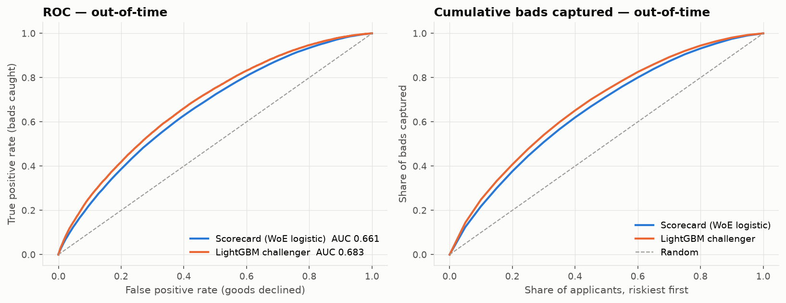
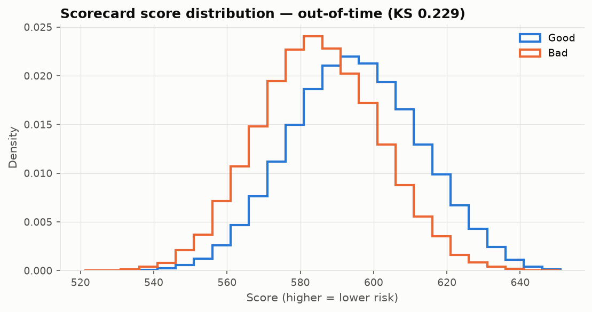
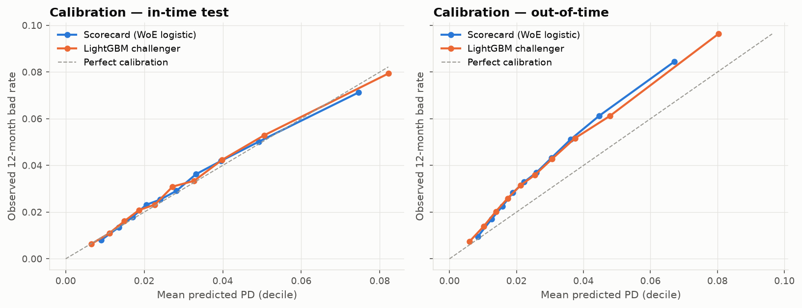
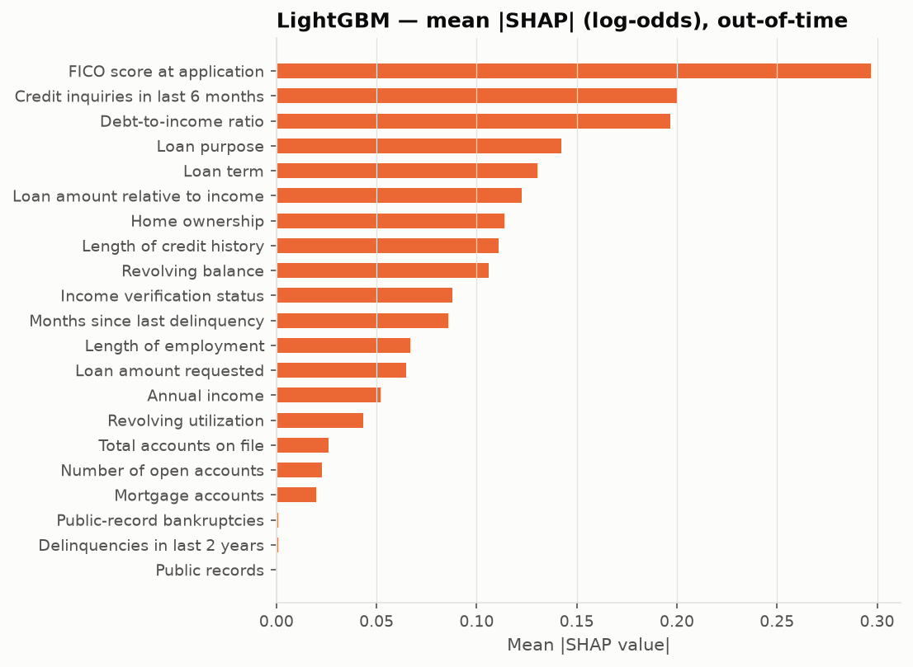
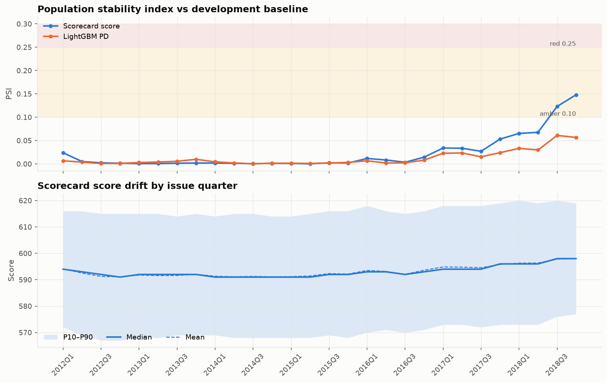
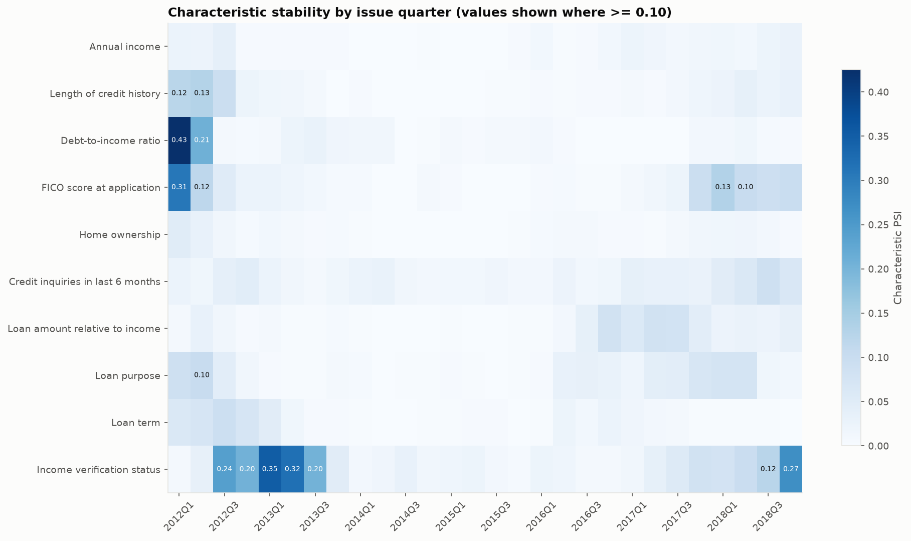
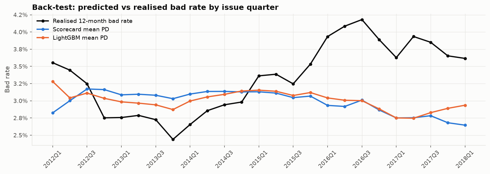
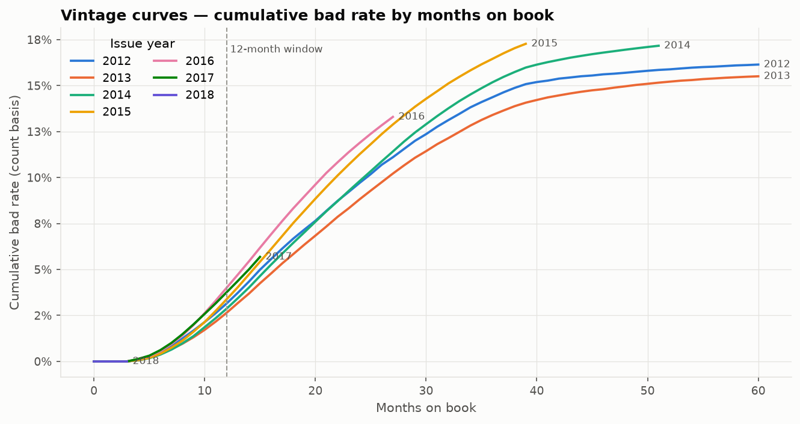

# Model development document — Lending Club application scorecard

| | |
|---|---|
| Model | 12-month application PD scorecard (champion candidate) with LightGBM challenger |
| Data | Lending Club accepted loans 2007–2018 (Kaggle `accepted_2007_to_2018Q4`), snapshot 2019-03-01 |
| Developer | Jose Thomas |
| Version / date | v1.0 / 2026-10-20 |
| Status | Development — not approved for use |

## 1. Purpose and scope

Rank and price new unsecured personal-loan applications by their probability of going bad within 12 months of issue,
using only information known at application. The scorecard is the interpretable benchmark (points per attribute,
adverse-action reasons by construction); LightGBM is the challenger that tests how much discrimination the
scorecard leaves on the table. Scope: individual (non-joint) applications, policy code 1, issued from
2012 onward.

## 2. Data and reconciliation

The raw file is loaded in PySpark, typed, and split into three mart tables (`loans`, `bureau`, `outcomes`) that are
joined back into an analytic base table. Each hop is counted; an independent DuckDB count of the raw file anchors the chain.

| Check | Rows | Expected | Status |
|---|---|---|---|
| raw rows (DuckDB, independent) | 2,260,701 |  | PASS |
| raw rows (Spark) | 2,260,701 | 2,260,701 | PASS |
| non-loan rows dropped (footer/summary lines) | 33 |  | PASS |
| duplicate loan ids | 0 |  | PASS |
| clean loans | 2,260,668 | 2,260,668 | PASS |
| loans with unparseable issue_d | 0 | 0.0 | PASS |
| loans table rows (re-read from parquet) | 2,260,668 | 2,260,668 | PASS |
| bureau table rows (re-read from parquet) | 2,260,668 | 2,260,668 | PASS |
| outcomes table rows (re-read from parquet) | 2,260,668 | 2,260,668 | PASS |
| joined loans ⋈ bureau ⋈ outcomes | 2,260,668 | 2,260,668 | PASS |
| loans without bureau row | 0 | 0.0 | PASS |
| loans without outcome row | 0 | 0.0 | PASS |

Warehouse mirror (BigQuery): row counts, distinct ids, an id checksum, null counts, column sums and date ranges
are compared table by table against Spark's control totals.

| Table | Spark rows | Warehouse rows | All checks |
|---|---|---|---|
| loans | 2260668 | 2260668 | 25/25 pass |
| bureau | 2260668 | 2260668 | 30/30 pass |
| outcomes | 2260668 | 2260668 | 7/7 pass |
| abt | 2260668 | 2260668 | 9/9 pass |

## 3. Target definition and windows

* **Observation point:** issue date. All characteristics are as reported at application.
* **Performance window:** 12 months from issue.
* **Bad:** charged off / default, or 90+ days past due, with the 90+ DPD date inside the window.
* **Good:** every other loan with a complete window — including loans repaid early and loans that went bad after month 12.
* **Immature:** issued less than 12 months before the 2019-03-01 snapshot; scored for monitoring, never labelled.

The file is a single status snapshot with no monthly payment history, so the 90+ DPD date is estimated as
`last_pymnt_d + 4 months` (the missed instalment falls due a month after the last
payment; 90 days later the loan is 90+ DPD). How snapshot statuses map to the 12-month flag in the modelling samples:

| Snapshot status | Bad within 12m | Loans |
|---|---|---|
| Charged Off | 1 | 61,701 |
| Charged Off | 0 | 191,024 |
| Current | 0 | 489,389 |
| Default | 0 | 31 |
| Default | 1 | 1 |
| Fully Paid | 0 | 997,254 |
| In Grace Period | 0 | 5,508 |
| Late (16-30 days) | 0 | 2,809 |
| Late (31-120 days) | 0 | 14,863 |
| Late (31-120 days) | 1 | 119 |

### Samples (out-of-time split by issue date)

| Sample | Loans | Bads | Bad rate | First issue | Last issue |
|---|---|---|---|---|---|
| Excluded | 163,245 | 3,987 | 3.61% | 2007-06-01 | 2018-12-01 |
| In-time test | 210,837 | 6,674 | 3.17% | 2012-01-01 | 2015-12-01 |
| Train | 633,557 | 19,625 | 3.10% | 2012-01-01 | 2015-12-01 |
| Out-of-time | 918,305 | 35,522 | 3.87% | 2016-01-01 | 2018-03-01 |
| Monitoring only (immature) | 334,724 |  |  | 2018-04-01 | 2018-12-01 |

Train and in-time test split the 2012–2015 development window
75/25 on a hash of the loan id. Out-of-time
covers mature loans issued after the development window. Exclusions: issued before min_issue_date (42,535), joint application (120,710).

## 4. Methodology

**Benchmark scorecard.** Each candidate characteristic is fine-classed into 20 quantile bins,
then coarse-classed by merging adjacent bins until weight of evidence is monotonic, every bin holds at least
5% of training loans, and no characteristic has more than 6 bins.
Characteristics with IV below 0.02 are dropped, the weaker of any pair with WoE correlation above
0.7 is dropped, and the logistic regression is pruned one characteristic at a time for wrong-signed
coefficients or p-values above 0.01. Scores are scaled to 600 points at
50:1 good:bad odds with 20 points to double the odds; attribute points are rounded to integers.

| Characteristic | IV | Decision | Reason |
|---|---|---|---|
| FICO score at application | 0.0859 | kept | IV 0.086, coef -0.775, p 7.2e-181 |
| Credit inquiries in last 6 months | 0.0717 | kept | IV 0.072, coef -0.934, p 2.5e-273 |
| Debt-to-income ratio | 0.0558 | kept | IV 0.056, coef -0.754, p 5e-124 |
| Income verification status | 0.0481 | kept | IV 0.048, coef -0.600, p 1.7e-61 |
| Loan purpose | 0.0445 | kept | IV 0.045, coef -0.981, p 3.8e-162 |
| Loan amount relative to income | 0.0422 | kept | IV 0.042, coef -0.497, p 4.7e-32 |
| Length of credit history | 0.0409 | kept | IV 0.041, coef -0.761, p 1.6e-89 |
| Annual income | 0.0387 | kept | IV 0.039, coef -0.396, p 1.3e-18 |
| Home ownership | 0.0366 | kept | IV 0.037, coef -0.673, p 1.4e-61 |
| Loan term | 0.0358 | kept | IV 0.036, coef -0.870, p 5.2e-93 |
| Mortgage accounts | 0.0301 | dropped | p-value 0.221 > 0.01 |
| Length of employment | 0.0186 | dropped | IV 0.0186 < 0.02 |
| Revolving balance | 0.0159 | dropped | IV 0.0159 < 0.02 |
| Revolving utilization | 0.0063 | dropped | IV 0.0063 < 0.02 |
| Total accounts on file | 0.0044 | dropped | IV 0.0044 < 0.02 |
| Months since last delinquency | 0.0028 | dropped | IV 0.0028 < 0.02 |
| Loan amount requested | 0.0021 | dropped | IV 0.0021 < 0.02 |
| Number of open accounts | 0.0006 | dropped | IV 0.0006 < 0.02 |
| Delinquencies in last 2 years | 0.0006 | dropped | IV 0.0006 < 0.02 |
| Public records | 0.0005 | dropped | IV 0.0005 < 0.02 |
| Public-record bankruptcies | 0.0004 | dropped | IV 0.0004 < 0.02 |

Final scorecard: 10 characteristics, pseudo-R² 0.040 on 633,557 training loans.
Full points table in Appendix A.

**Challenger.** LightGBM on all 21 candidate characteristics, un-binned, with native handling of
categoricals and missing values. Early stopping (best iteration 498) uses a 10% slice of the
training sample so the in-time test and out-of-time samples are never seen during fitting. Monotone constraints are
imposed on FICO score at application, Revolving utilization, Credit inquiries in last 6 months, Delinquencies in last 2 years, Public records, Public-record bankruptcies, Debt-to-income ratio, Loan amount relative to income, so a better value can never raise PD
and reason codes stay defensible.

## 5. Performance

| Model | Sample | Loans | Bad rate | Mean PD | AUC | Gini | KS | ECE |
|---|---|---|---|---|---|---|---|---|
| Scorecard (WoE logistic) | Train | 633,557 | 3.1% | 3.1% | 0.67 | 0.34 | 0.248 | 0.0017 |
| LightGBM challenger | Train | 633,557 | 3.1% | 3.1% | 0.737 | 0.474 | 0.348 | 0.0043 |
| Scorecard (WoE logistic) | In-time test | 210,837 | 3.2% | 3.1% | 0.663 | 0.326 | 0.238 | 0.0016 |
| LightGBM challenger | In-time test | 210,837 | 3.2% | 3.1% | 0.686 | 0.372 | 0.268 | 0.0016 |
| Scorecard (WoE logistic) | Out-of-time | 918,305 | 3.9% | 2.8% | 0.661 | 0.321 | 0.229 | 0.0105 |
| LightGBM challenger | Out-of-time | 918,305 | 3.9% | 2.9% | 0.683 | 0.367 | 0.263 | 0.0096 |

ECE = expected calibration error across PD deciles. Out-of-time, the challenger's Gini is
higher by 4.6 points.

### Lift — out-of-time, scorecard

| Decile (1 = riskiest) | Loans | Bads | Bad rate | Cum. bads captured | Lift | KS |
|---|---|---|---|---|---|---|
| 1 | 91,831 | 7,760 | 8.5% | 21.8% | 2.18 | 0.123 |
| 2 | 91,830 | 5,609 | 6.1% | 37.6% | 1.58 | 0.183 |
| 3 | 91,831 | 4,690 | 5.1% | 50.8% | 1.32 | 0.217 |
| 4 | 91,830 | 3,961 | 4.3% | 62.0% | 1.12 | 0.229 |
| 5 | 91,831 | 3,375 | 3.7% | 71.5% | 0.95 | 0.224 |
| 6 | 91,830 | 3,032 | 3.3% | 80.0% | 0.85 | 0.208 |
| 7 | 91,830 | 2,614 | 2.8% | 87.4% | 0.74 | 0.181 |
| 8 | 91,831 | 2,056 | 2.2% | 93.2% | 0.58 | 0.137 |
| 9 | 91,830 | 1,554 | 1.7% | 97.5% | 0.44 | 0.079 |
| 10 | 91,831 | 871 | 0.9% | 100.0% | 0.25 | 0.0 |

### Lift — out-of-time, LightGBM

| Decile (1 = riskiest) | Loans | Bads | Bad rate | Cum. bads captured | Lift | KS |
|---|---|---|---|---|---|---|
| 1 | 91,831 | 8,845 | 9.6% | 24.9% | 2.49 | 0.155 |
| 2 | 91,830 | 5,621 | 6.1% | 40.7% | 1.58 | 0.216 |
| 3 | 91,831 | 4,745 | 5.2% | 54.1% | 1.34 | 0.251 |
| 4 | 91,830 | 3,931 | 4.3% | 65.1% | 1.11 | 0.262 |
| 5 | 91,831 | 3,298 | 3.6% | 74.4% | 0.93 | 0.254 |
| 6 | 91,830 | 2,886 | 3.1% | 82.6% | 0.81 | 0.235 |
| 7 | 91,830 | 2,379 | 2.6% | 89.3% | 0.67 | 0.2 |
| 8 | 91,831 | 1,860 | 2.0% | 94.5% | 0.52 | 0.151 |
| 9 | 91,830 | 1,283 | 1.4% | 98.1% | 0.36 | 0.084 |
| 10 | 91,831 | 674 | 0.7% | 100.0% | 0.19 | 0.0 |

### Calibration

In time, realised bad rate / mean PD = 1.02 (well calibrated). Out of time the ratio is 1.37 (3.9% realised vs 2.8% predicted). Rank ordering holds out of time but the PD level does not: changes in the applicant mix (section 7) show up in the scores, but the realised bad rate exceeded what they imply, so risk at a given score has also moved (see the back-test by quarter). PDs used for pricing or loss forecasting need a recalibration (intercept shift) on the latest mature vintages; the score ranking can stay.

## 6. Reason codes

* **Scorecard:** for each characteristic, the points shortfall against the maximum attainable points; the four largest shortfalls are the reasons.
* **LightGBM:** exact TreeSHAP contributions in log-odds (LightGBM `pred_contrib`; additivity verified to 2.0e-14); the four largest positive contributions are the reasons.

In the decline zone (riskiest 20% by score, out-of-time) the two methods give the same primary reason for
54% of applicants and share 63% of their top-four reasons.
Sample (lowest out-of-time scores):

| Loan id | Score | Scorecard #1 | Scorecard #2 | SHAP #1 | SHAP #2 |
|---|---|---|---|---|---|
| 78,649,960 | 523 | Loan purpose | FICO score at application | Debt-to-income ratio | Credit inquiries in last 6 months |
| 74,581,519 | 524 | Credit inquiries in last 6 months | Loan purpose | Credit inquiries in last 6 months | Revolving balance |
| 74,514,494 | 524 | Credit inquiries in last 6 months | Loan purpose | Credit inquiries in last 6 months | Loan purpose |
| 73,531,084 | 525 | Credit inquiries in last 6 months | Loan purpose | Credit inquiries in last 6 months | Debt-to-income ratio |
| 83,725,659 | 526 | Loan purpose | FICO score at application | Debt-to-income ratio | Credit inquiries in last 6 months |
| 112,555,161 | 526 | Credit inquiries in last 6 months | Loan purpose | Credit inquiries in last 6 months | Loan amount relative to income |
| 86,116,416 | 526 | Credit inquiries in last 6 months | FICO score at application | Credit inquiries in last 6 months | FICO score at application |
| 95,160,185 | 526 | Credit inquiries in last 6 months | Loan purpose | Loan purpose | Credit inquiries in last 6 months |

## 7. Monitoring

Every issue quarter is scored and compared with the training baseline: score PSI on baseline deciles, characteristic
PSI and points shift for each scorecard characteristic, score percentiles, and predicted vs realised bad rate for
mature quarters. Thresholds: PSI < 0.1 green, 0.1–0.25 amber (investigate), ≥ 0.25 red (escalate; recalibrate or redevelop).

* Amber quarters: 2018Q3, 2018Q4.
* Red quarters: none.
* Largest characteristic shifts: Debt-to-income ratio PSI 0.43 in 2012Q1 (+2.3 points); Income verification status PSI 0.35 in 2013Q1 (-0.2 points); FICO score at application PSI 0.31 in 2012Q1 (+4.0 points).

## 8. Implementation test

The scorecard was rescored by `production/score_scorecard.sql` (DuckDB; a BigQuery translation is generated alongside)
from the mart tables and the exported points table alone, and the challenger by `production/score_challenger.py`, a
standalone script that rebuilds every feature itself. A negative control re-runs the SQL with one bin edge coded as
`<` instead of `<=`; the test must catch it. Overall: **PASS**.

| Part | Check | Value | Expected | Status |
|---|---|---|---|---|
| A | loans scored — development | 2,097,423 |  | info |
| A | loans scored — production SQL | 2,097,423 | 2,097,423 | PASS |
| A | in development only | 0 | 0 | PASS |
| A | in production only | 0 | 0 | PASS |
| A | loans not scored on every characteristic | 0 | 0 | PASS |
| A | score mismatches (exact integer match required) | 0 | 0 | PASS |
| A | max \|score difference\| | 0 | 0 | PASS |
| A | max \|PD difference\| | 0 |  | info |
| A | characteristic-level points mismatches | 0 | 0 | PASS |
| B | loans scored — development | 2,097,423 |  | info |
| B | loans scored — production script | 2,097,423 | 2,097,423 | PASS |
| B | in development only | 0 | 0 | PASS |
| B | in production only | 0 | 0 | PASS |
| B | PD mismatches beyond 1e-09 | 0 | 0 | PASS |
| B | max \|PD difference\| | 0 |  | info |
| C | negative control: 'fico' bin edge 682 coded as < instead of <=; mismatches detected | 157,457 | > 0 | PASS |

## 9. Recommendation

Champion: **LightGBM challenger**. The challenger clears the adoption bar (≥ 3 Gini points out of time with no worse calibration).
Before use: recalibrate PD levels on the most recent mature vintages and confirm the monitoring thresholds with the model owner.

## 10. Assumptions

1. The 90+ DPD date is `last_pymnt_d + 4` months. Loans that make partial payments while delinquent will have their bad date estimated late.
2. A loan that reached 90+ DPD and later cured is invisible in a snapshot; it is treated as good. Cures from 90+ DPD are rare in unsecured consumer lending, so the bad rate is understated only slightly.
3. Bureau attributes in the file are those reported at application, as Lending Club documents them.
4. Accepted loans are representative of future applicants who would be accepted (no reject inference; see limitations).
5. Snapshot date = latest `last_pymnt_d` in the file (2019-03-01).

## 11. Limitations

1. **Accepted-only sample.** Rejected applicants' outcomes are unknown, so the model is trained on a population already filtered by Lending Club's policy and scoring. Discrimination on the full through-the-door population is likely overstated. Reject inference (e.g. parcelling with the Kaggle `rejected` file, which carries only a few attributes) is the next step.
2. **No payment history.** The target uses an estimated 90+ DPD date rather than observed monthly delinquency; roll rates and cure behaviour cannot be modelled.
3. **Lending-policy changes** inside the window (credit-policy tightening, new fields added mid-period, joint applications from late 2015) mean some characteristics are not comparable across years. Null rates by vintage (in `binning_detail.csv` and the CSI heatmap) should be checked before trusting any characteristic whose population changes mid-period.
4. **Out-of-time level shift.** PDs under-predict out-of-time vintages; see section 5.
5. **Fair lending.** No protected attributes are present, but home ownership and income can proxy for them; disparate-impact testing is outside this project's data.
6. **Public data.** Lending Club's own grade and interest rate are excluded, so this is not a replication of Lending Club's model.

## 12. Decision log

| # | Decision | Alternatives considered | Rationale |
|---|---|---|---|
| 1 | Bad = CO/default or 90+ DPD within 12 months | 18/24-month windows; lifetime charge-off | 12 months is the standard application-scorecard horizon and leaves the most recent vintages usable for out-of-time testing. |
| 2 | Estimate the 90+ DPD date from `last_pymnt_d` | Use charge-off status only, ignoring timing | Without timing, loans charged off at month 30 would count as 12-month bads. |
| 3 | Out-of-time split by issue date; in-time split by id hash | Random split only | Out-of-time is the honest test for a model that will score future vintages; the id hash keeps splits reproducible across Spark and pandas. |
| 4 | Start the population in 2012; individual applications; policy code 1 | Use all years and application types | Pre-2012 vintages are small and pre-date current policy; joint applications carry a second borrower's bureau file. |
| 5 | Exclude grade, sub-grade and interest rate | Include them | They are outputs of Lending Club's own risk model; including them would turn the scorecard into a re-weighting of that model. |
| 6 | Exclude post-origination fields (last FICO, payments, recoveries) | — | Target leakage. |
| 7 | Monotonic WoE bins, ≥ 5% per bin, ≤ 6 bins | Free-form or tree-based bins | Monotone points are explainable to applicants and stable over time. |
| 8 | High IV flagged for review, not auto-dropped | Drop IV > 0.5 | FICO legitimately carries high IV; leakage is a question about timing, which a human must answer. |
| 9 | Integer points; SQL scoring from the points table | Score from coefficients | The points table is the hand-off artefact; integer points make the implementation test an exact match. |
| 10 | Early stopping on a slice of train | Early stopping on in-time test or OOT | Keeps both test samples untouched. |
| 11 | Monotone constraints in LightGBM | Unconstrained | Defensible reason codes and behaviour; costs little discrimination. |
| 12 | Scorecard reasons by points shortfall; LightGBM by TreeSHAP | Permutation importance; LIME | Both are exact and per-applicant. |
| 13 | PSI thresholds 0.10 / 0.25 | Other cut-offs | Industry convention; revisit with the model owner. |
| 14 | Challenger adoption bar: +3 Gini points out of time, calibration no worse | Adopt whichever scores higher | Interpretability and implementation cost justify a margin. |

## Appendix A — scorecard points table

| Characteristic | Attribute | Count | WoE | Points |
|---|---|---|---|---|
| FICO score at application | <= 662 | 58,184 | -0.357 | 51 |
| FICO score at application | > 662 and <= 667 | 57,141 | -0.279 | 52 |
| FICO score at application | > 667 and <= 682 | 160,195 | -0.179 | 55 |
| FICO score at application | > 682 and <= 697 | 126,862 | -0.013 | 58 |
| FICO score at application | > 697 and <= 712 | 93,657 | 0.207 | 63 |
| FICO score at application | > 712 | 137,518 | 0.539 | 71 |
| FICO score at application | Missing | 0 | -0.357 | 51 |
| Credit inquiries in last 6 months | <= 0 | 358,708 | 0.227 | 65 |
| Credit inquiries in last 6 months | > 0 and <= 1 | 172,545 | -0.095 | 56 |
| Credit inquiries in last 6 months | > 1 and <= 2 | 66,158 | -0.34 | 49 |
| Credit inquiries in last 6 months | > 2 | 36,146 | -0.612 | 42 |
| Credit inquiries in last 6 months | Missing | 0 | -0.612 | 42 |
| Debt-to-income ratio | <= 13.33 | 190,156 | 0.271 | 65 |
| Debt-to-income ratio | > 13.33 and <= 17.89 | 126,683 | 0.144 | 62 |
| Debt-to-income ratio | > 17.89 and <= 21.48 | 95,097 | 0.024 | 59 |
| Debt-to-income ratio | > 21.48 and <= 22.82 | 31,697 | -0.058 | 57 |
| Debt-to-income ratio | > 22.82 and <= 25.84 | 63,266 | -0.138 | 56 |
| Debt-to-income ratio | > 25.84 | 126,658 | -0.357 | 51 |
| Debt-to-income ratio | Missing | 0 | -0.357 | 51 |
| Income verification status | Not Verified | 180,283 | 0.359 | 65 |
| Income verification status | Source Verified | 245,014 | -0.022 | 58 |
| Income verification status | Verified | 208,260 | -0.214 | 55 |
| Loan purpose | credit_card | 150,588 | 0.357 | 69 |
| Loan purpose | home_improvement | 36,524 | 0.023 | 59 |
| Loan purpose | debt_consolidation | 378,149 | -0.042 | 57 |
| Loan purpose | car, educational, house, major_purchase, medical, moving, other, renewable_energy, small_business, vacation, wedding | 68,296 | -0.371 | 48 |
| Loan amount relative to income | <= 0.0833333 | 61,776 | 0.249 | 62 |
| Loan amount relative to income | > 0.0833333 and <= 0.197802 | 223,282 | 0.183 | 61 |
| Loan amount relative to income | > 0.197802 and <= 0.244648 | 95,074 | 0.072 | 60 |
| Loan amount relative to income | > 0.244648 and <= 0.28172 | 63,357 | -0.016 | 58 |
| Loan amount relative to income | > 0.28172 and <= 0.35125 | 95,045 | -0.202 | 56 |
| Loan amount relative to income | > 0.35125 | 95,023 | -0.324 | 54 |
| Loan amount relative to income | Missing | 0 | -0.324 | 54 |
| Length of credit history | <= 79 | 31,915 | -0.363 | 51 |
| Length of credit history | > 79 and <= 137 | 129,748 | -0.234 | 54 |
| Length of credit history | > 137 and <= 162 | 92,347 | -0.072 | 57 |
| Length of credit history | > 162 and <= 190 | 96,736 | 0.009 | 59 |
| Length of credit history | > 190 and <= 228 | 94,478 | 0.11 | 61 |
| Length of credit history | > 228 | 188,333 | 0.262 | 64 |
| Length of credit history | Missing | 0 | -0.363 | 51 |
| Annual income | <= 28500 | 31,848 | -0.394 | 54 |
| Annual income | > 28500 and <= 42000 | 97,224 | -0.221 | 56 |
| Annual income | > 42000 and <= 65000 | 203,436 | -0.062 | 58 |
| Annual income | > 65000 and <= 84000 | 112,189 | 0.08 | 60 |
| Annual income | > 84000 and <= 99258 | 62,148 | 0.175 | 61 |
| Annual income | > 99258 | 126,712 | 0.302 | 62 |
| Annual income | Missing | 0 | -0.394 | 54 |
| Home ownership | MORTGAGE, OTHER | 318,677 | 0.205 | 63 |
| Home ownership | OWN | 62,966 | -0.079 | 57 |
| Home ownership | RENT | 251,914 | -0.196 | 55 |
| Loan term | 36 | 441,931 | 0.137 | 62 |
| Loan term | 60 | 191,626 | -0.262 | 52 |

Missing values take the riskiest bin's points unless they are frequent enough to earn their own bin; an unseen
category takes the riskiest category group's points.
